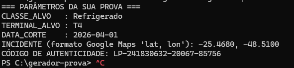

=== PARÂMETROS DA SUA PROVA ===
CLASSE_ALVO   : Refrigerado
TERMINAL_ALVO : T4
DATA_CORTE    : 2026-04-01
INCIDENTE (formato Google Maps 'lat, lon'): -25.4680, -48.5100
CÓDIGO DE AUTENTICIDADE: LP-241830632-20067-85756
