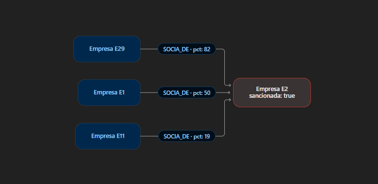
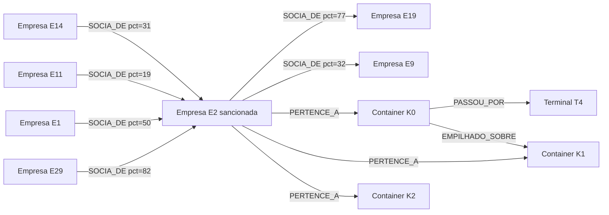

# Parte C — Neo4j

Parâmetro: empresa sancionada `E2`.

## C1 — Modelagem

### Nós

```cypher
CREATE (:Terminal {nome: "T1"});
CREATE (:Terminal {nome: "T2"});
CREATE (:Terminal {nome: "T3"});
CREATE (:Terminal {nome: "T4"});
CREATE (:Terminal {nome: "T5"});
```

A carga completa das 30 empresas usa `UNWIND` e propriedades `cnpj`, `nome` e `sancionada`. Os contêineres usam `id` e `classe`; o terminal usa `nome`. Os relacionamentos são propriedades dos nós relacionados, não tabelas associativas.

### Relacionamentos

```cypher
// Empresa -> Empresa
(a:Empresa)-[:SOCIA_DE {pct: integer}]->(b:Empresa)

// Container -> Empresa
(c:Container)-[:PERTENCE_A]->(e:Empresa)

// Container -> Terminal
(c:Container)-[:PASSOU_POR {data: string}]->(t:Terminal)

// Container superior -> Container inferior
(top:Container)-[:EMPILHADO_SOBRE]->(base:Container)
```

Para as relações `PASSOU_POR`, converter `data` com `date(p.data)` nas consultas torna a comparação determinística.

### Subgrafo real da empresa sancionada

Os sócios diretos representados no grafo são:

```text
Empresa E29 -SOCIA_DE {pct: 82}-> Empresa E2
Empresa E1  -SOCIA_DE {pct: 50}-> Empresa E2
Empresa E11 -SOCIA_DE {pct: 19}-> Empresa E2
```



```cypher
MATCH (e:Empresa {cnpj: "E2"})-[r:SOCIA_DE]-(s:Empresa)
RETURN
  s.cnpj AS socio,
  startNode(r).cnpj AS origem,
  endNode(r).cnpj AS destino,
  r.pct AS pct
ORDER BY socio;
```

O diagrama usa nós representando as entidades e propriedades nos relacionamentos:



## C2 — Investigação societária e operacional

A direção foi escolhida pela semântica da participação: percorremos `SOCIA_DE` nos dois sentidos porque o enunciado pede todas as empresas ligadas à sancionada, independentemente de qual nó possui o relacionamento de saída.

```cypher
MATCH (sancionada:Empresa {cnpj: "E2"})
MATCH (investigada:Empresa)-[:SOCIA_DE*1..3]-(sancionada)
WHERE investigada <> sancionada

MATCH (c1:Container)-[:PERTENCE_A]->(sancionada)
MATCH (c1)-[p1:PASSOU_POR]->(t:Terminal)
MATCH (c2:Container)-[:PERTENCE_A]->(investigada)
MATCH (c2)-[p2:PASSOU_POR]->(t)
WHERE date(p1.data) = date(p2.data)

RETURN DISTINCT
  investigada.nome AS empresa,
  c2.id AS container,
  t.nome AS terminal,
  date(p2.data) AS data
ORDER BY empresa, data, container;
```

```cypher
MATCH (c:Container)-[r:PASSOU_POR]->(t:Terminal)
RETURN properties(r) AS propriedades_passagem,
       properties(t) AS propriedades_terminal
LIMIT 5;
```

Registrar a saída real da primeira consulta como evidência, incluindo somente linhas distintas.

## C3 — Debug Cypher

### i) Duplicação de empresas

Sintoma: criar um novo nó `E1` com `CREATE` produz uma segunda empresa com o mesmo `cnpj`.

Causa: `CREATE` não verifica existência; o nó existente não é localizado.

```cypher
MATCH (e:Empresa)
WHERE e.cnpj IN ["E1", "E2"]
RETURN elementId(e) AS id_interno,
       properties(e) AS propriedades;
```

Remover somente os nós duplicados recém-criados:

```cypher
MATCH (e:Empresa)
WHERE e.cnpj IN ["E1", "E2"]
  AND e.nome IS NULL
  AND e.sancionada IS NULL
DETACH DELETE e;
```

Correção: localizar os nós antes de criar o relacionamento.

```cypher
MATCH (a:Empresa {cnpj: "E1"})
MATCH (b:Empresa {cnpj: "E2"})
MERGE (a)-[:SOCIA_DE {pct: 30}]->(b);
```

### ii) Recorrência ilimitada

Sintoma: a consulta pode percorrer ciclos e usar muita memória ou ultrapassar o limite seguro de execução.

Causa: `*` sem limite inferior e superior permite caminhos arbitrários no grafo.

```cypher
MATCH (s:Empresa {sancionada: true})-[:SOCIA_DE*1..3]-(x:Empresa)
WHERE x <> s
RETURN DISTINCT x.nome AS empresa
LIMIT 20;
```

### iii) Contêineres acima da base da pilha

Sintoma: a consulta original segue a direção errada ou não encontra todos os contêineres superiores.

Causa: `EMPILHADO_SOBRE` aponta do contêiner de cima para o contêiner da base. Para encontrar os contêineres acima da base, a direção deve ser invertida.

```cypher
MATCH (topo:Container)-[:EMPILHADO_SOBRE*1..3]->(base:Container {id: "BASE_DA_PILHA"})
RETURN DISTINCT topo.id AS id
ORDER BY id;
```

### iv) Contagem de contêineres perigosos por terminal

Sintoma: `count(k)` pode contar passagens repetidas do mesmo contêiner em vez de contêineres distintos.

Causa: não existe `DISTINCT` na agregação.

```cypher
MATCH (k:Container)-[:PASSOU_POR]->(t:Terminal)
WHERE k.classe = "Perigoso"
RETURN t.nome AS terminal,
       count(DISTINCT k) AS contêineres_perigosos
ORDER BY terminal;
```

### Auditoria do grafo

```cypher
MATCH (a)-[r]->(b)
RETURN
  type(r) AS relacionamento,
  labels(a) AS origem,
  keys(a) AS propriedades_origem,
  keys(r) AS propriedades_relacionamento,
  labels(b) AS destino,
  keys(b) AS propriedades_destino,
  count(*) AS quantidade
ORDER BY relacionamento;
